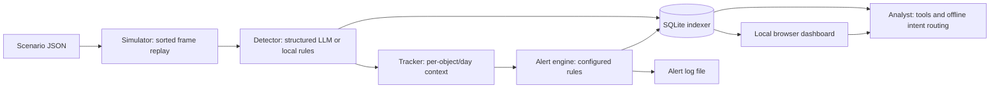
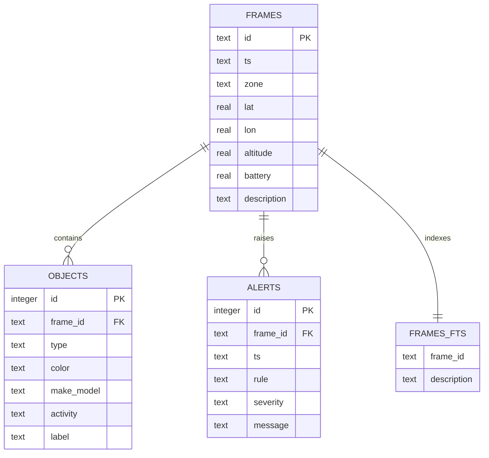

# Architecture

## Data pipeline

- **Simulator:** loads typed frames and sorts by timestamp; optional replay speed inserts delays.
- **Detector:** extracts object type, color, model, activity, zone, and label from the simulated text. It uses a LangChain structured-output model only when a configured provider key exists.
- **Tracker:** accumulates first/last seen times, event counts, consecutive-frame counts, and zones visited.
- **Alert engine:** evaluates tracker state and telemetry with local rules, suppressing repeated object alerts.
- **Indexer:** stores source frames, detections, and alerts and maintains an FTS5 description index.
- **Analyst:** answers via the same indexer operations in either local intent-routing or optional tool-calling mode.
- **Dashboard:** serves a dependency-free local browser UI for patrol controls, live output, alerts, frame searches, and analyst Q&A.

## Database schema

The frame ID is the scenario's stable ID. Object and alert rows reference that frame; deleting/replaying a frame replaces its associated records. `frames_fts` is an FTS5 virtual table kept in sync as each frame is indexed.
